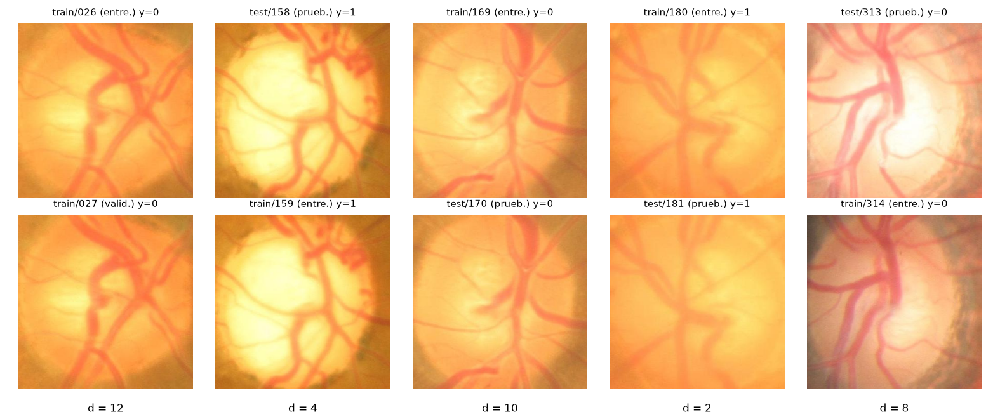
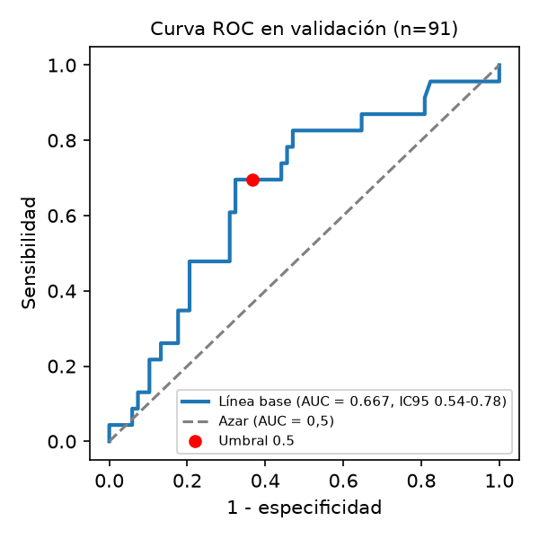
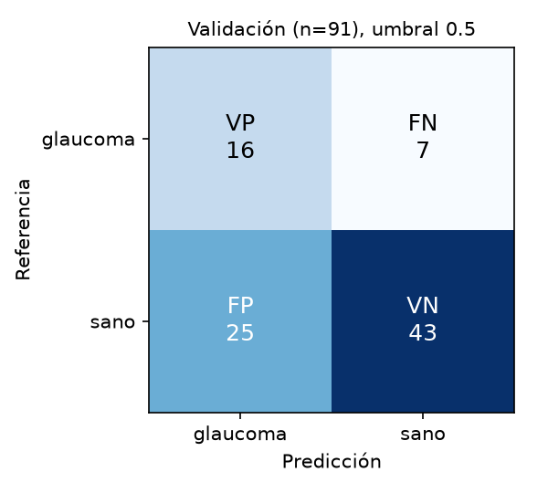
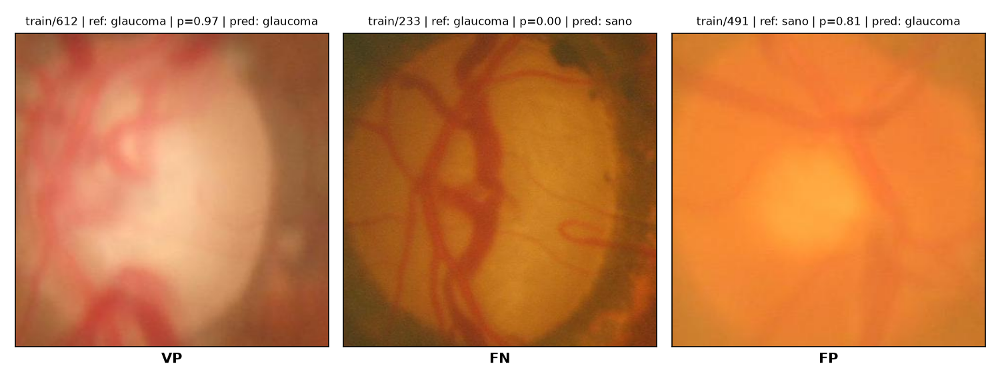

# Identificación de glaucoma en imágenes de fondo de ojo


Proyecto del curso **Imágenes Médicas (34740)**, Departamento de Ingeniería de Sistemas, Pontificia Universidad Javeriana.
**Proyecto B:** clasificar imágenes de fondo de ojo del conjunto ORIGA-light como *glaucoma* o *sano*.

> Trabajo académico. Los resultados son preliminares y no constituyen una herramienta de diagnóstico clínico.

## Pregunta de trabajo

¿Es posible identificar la presencia de glaucoma a partir de imágenes digitales de fondo de ojo mediante un
método de clasificación, usando como referencia las etiquetas clínicas del conjunto de datos?

## Datos

- **ORIGA-light** (Singapore Eye Research Institute; Zhang et al., EMBC 2010), copia pública en
  [Kaggle](https://www.kaggle.com/datasets/ferencjuhsz/origa-retinal-fundus-image-dataset).
- 650 recortes RGB centrados en el disco óptico (255×255 a 493×493 px): 168 con glaucoma y 482 sanos.
- Las imágenes **no se incluyen** en este repositorio. Para ejecutar el código, descarga el conjunto y
  ubica la carpeta `archive/` dentro de `SegundaEntrega/` (o ajusta `data_dir` en `config.yaml`).

## Estructura

```
.
├── SegundaEntrega/
│   ├── codigo/                  # scripts 01–06, configuración y salidas
│   │   ├── config.yaml          # semilla, parámetros y revisión visual de pares
│   │   ├── 01_inventario.py ... 06_analisis_error.py
│   │   ├── resultados/          # tablas, métricas (JSON) y verificación de la partición
│   │   └── figuras/             # ROC, matriz de confusión, casos y pares repetidos
│   └── informe/                 # informe en LaTeX (plantilla Springer Nature) y figuras
└── LICENSE
```

## Ejecución rápida

```bash
cd SegundaEntrega/codigo
python3 -m venv .venv && source .venv/bin/activate
pip install -r requirements.txt
for s in 01_inventario 02_particion 03_verificar_particion 04_linea_base 05_figuras 06_analisis_error; do
  python $s.py
done
```

Todo corre en CPU en menos de un minuto. Los detalles están en [`SegundaEntrega/codigo/README.md`](SegundaEntrega/codigo/README.md).

## Entrega 2: partición y línea base

**Partición.** Se respeta la división `train`/`test` de la copia y se toma el 20 % de `train` como validación,
estratificada por etiqueta (semilla 42).

| Partición | Imágenes | Glaucoma | Sano |
|---|---:|---:|---:|
| Entrenamiento | 363 | 94 | 269 |
| Validación | 91 | 23 | 68 |
| Prueba (reservada) | 196 | 51 | 145 |

**Verificación de fuga.** Además de códigos y MD5, se compararon hashes perceptuales (pHash) y se revisaron
a ojo los pares cercanos. Se encontraron 9 pares de tomas del mismo ojo, 5 de ellos entre particiones.
Las 4 imágenes de prueba con un gemelo en entrenamiento se excluirán de la evaluación final
([`prueba_excluidos.csv`](SegundaEntrega/codigo/resultados/prueba_excluidos.csv)).



**Línea base.** Ocho medidas de color y palidez central en la región del disco óptico, estandarizadas y
clasificadas con regresión logística balanceada (sin ajuste de hiperparámetros, umbral 0,5).
Resultados sobre la validación (n = 91), con IC 95 % por *bootstrap* estratificado:

| Métrica | Línea base | IC 95 % | Siempre "sano" |
|---|---:|---:|---:|
| Sensibilidad | 0,696 (16/23) | 0,52–0,87 | 0 |
| Especificidad | 0,632 (43/68) | 0,51–0,74 | 1 |
| AUC-ROC | 0,667 | 0,54–0,78 | 0,5 |
| F1 (glaucoma) | 0,500 | 0,38–0,61 | 0 |

<p align="center">
  
  
</p>



La señal es débil: las probabilidades se concentran cerca de 0,5 y el modelo responde más al brillo general
de la toma que a la palidez de la copa. El análisis del falso negativo `train/233` está en
[`analisis_error.txt`](SegundaEntrega/codigo/resultados/analisis_error.txt).

**Próximo paso.** Sustituir las características hechas a mano por las de una ResNet-18 preentrenada,
manteniendo el mismo clasificador, la misma partición y la misma validación para comparar.

## Equipo

- Giuseppe Kanyike Buwule
- Daniel Duque
- Juan David Daza

Profesor: Xavier Díaz. Bogotá D. C., 2026.

## Licencia

El código se publica bajo licencia [MIT](LICENSE). El conjunto ORIGA-light pertenece a sus autores y no se
redistribuye aquí.
