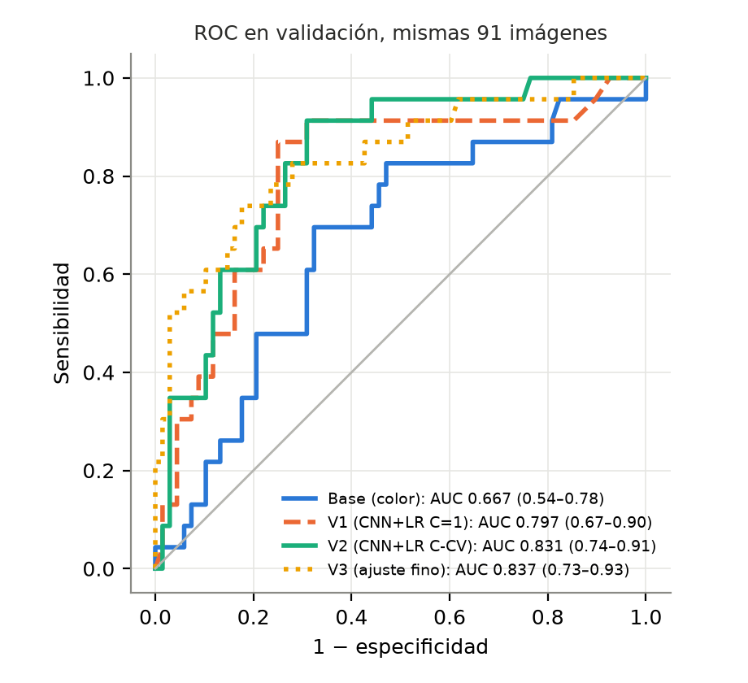
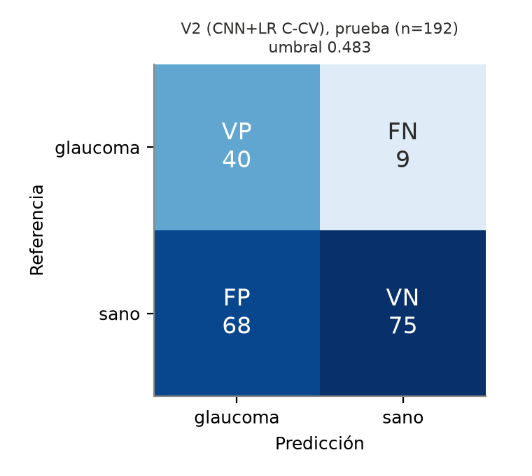
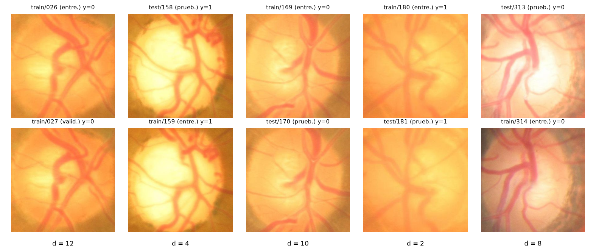
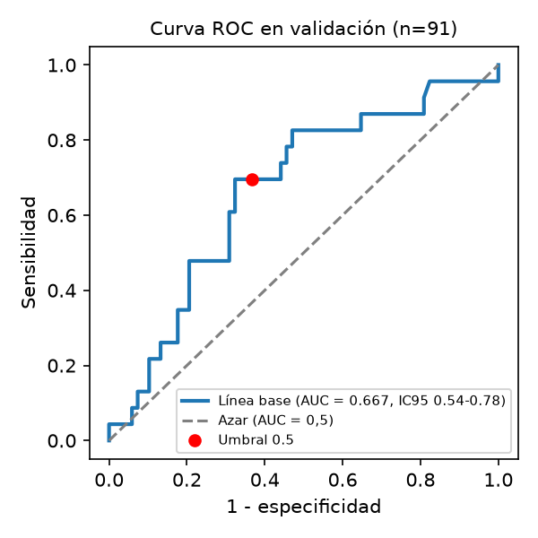
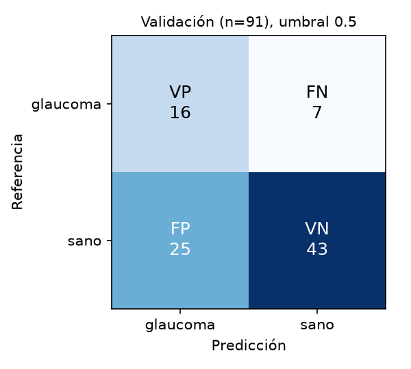
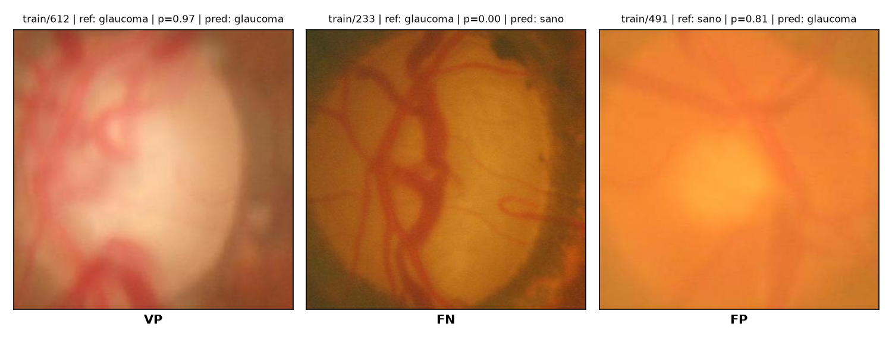

# Identificación de glaucoma en imágenes de fondo de ojo


Proyecto del curso **Imágenes Médicas (34740)**, Departamento de Ingeniería de Sistemas, Pontificia Universidad Javeriana.
**Proyecto B:** clasificar imágenes de fondo de ojo del conjunto ORIGA-light como *glaucoma* o *sano*.

> Trabajo académico. Los resultados no constituyen una herramienta de diagnóstico clínico.

## Pregunta de trabajo

¿Es posible identificar la presencia de glaucoma a partir de imágenes digitales de fondo de ojo mediante un
método de clasificación, usando como referencia las etiquetas clínicas del conjunto de datos?

## Datos

- **ORIGA-light** (Singapore Eye Research Institute; Zhang et al., EMBC 2010), copia pública en
  [Kaggle](https://www.kaggle.com/datasets/ferencjuhsz/origa-retinal-fundus-image-dataset).
- 650 recortes RGB centrados en el disco óptico (255×255 a 493×493 px): 168 con glaucoma y 482 sanos.
- Las imágenes **no se incluyen** en este repositorio. Para ejecutar el código, descarga el conjunto y
  ubica la carpeta `archive/` dentro de `TerceraEntrega/` (o ajusta `data_dir` en `config.yaml`).

## Entregas

| Entrega | Contenido | Documento |
|---|---|---|
| 1 | Problema clínico y técnico, datos, partición propuesta y métricas | [`E1_Proyecto_[B]_Equipo02_2026-30.pdf.docx`](PrimeraEntrega/) |
| 2 | Partición, control de fuga y línea base en validación (preliminar) | [`SegundaEntrega/informe/main.tex`](SegundaEntrega/informe/main.tex) |
| 3 (final) | Base frente a variantes ResNet-18, versión congelada y evaluación única en prueba | [`EF_Proyecto_B_Equipo02_2026-30.pdf`](TerceraEntrega/EF_Proyecto_B_Equipo02_2026-30.pdf) · [presentación](TerceraEntrega/presentacion/Presentacion.pdf) |

El ZIP de evidencias de la entrega final (código, resultados y pesos, incluido `modelo_v3.pt`) se comparte por OneDrive; no está en el repositorio.

## Estructura

```
.
├── TerceraEntrega/              # entrega final (versión vigente)
│   ├── EF_Proyecto_B_Equipo02_2026-30.pdf   # informe final compilado
│   ├── codigo/                  # scripts 01–13, predecir.py, modelos.py, config.yaml
│   │   ├── modelos/             # pesos: base, V1, V2 (joblib); V3 (.pt, fuera de git)
│   │   ├── resultados/          # partición, comparación en validación, prueba, análisis
│   │   └── figuras/
│   ├── informe/                 # informe final en LaTeX (Springer Nature) y figuras
│   └── presentacion/            # diapositivas HTML/PDF y guion de la sustentación
├── SegundaEntrega/              # Entrega 2: partición y línea base (scripts 01–06)
├── PrimeraEntrega/              # Entrega 1: informe (.docx)
└── LICENSE
```

## Ejecución rápida

```bash
cd TerceraEntrega/codigo
python3 -m venv .venv && source .venv/bin/activate
pip install -r requirements.txt
for s in 01_inventario 02_particion 03_verificar_particion 04_linea_base 05_figuras 06_analisis_error \
         07_extraer_cnn 08_variantes_lr 09_ajuste_fino 10_comparacion_validacion; do python $s.py; done
python 11_evaluacion_prueba.py --forzar   # reproduce la evaluación única en prueba
python 12_figuras_final.py && python 13_analisis_prueba.py
python predecir.py ../archive/ORIGA/test/580.jpg
```

Todo corre en CPU en unos 5 minutos; el ajuste fino de V3 es el paso más lento. Los detalles están en [`TerceraEntrega/codigo/README.md`](TerceraEntrega/codigo/README.md).

## Entrega final: base frente a variantes y evaluación en prueba

Todas las versiones se ajustan con las 363 imágenes de entrenamiento y se comparan sobre las mismas 91 de validación.
La regla de selección se fijó antes de comparar: gana el mayor AUC y, si la diferencia es menor de 0,01, gana la versión más simple.

| Versión | Qué cambia | Sensibilidad (umbral 0,5) | Especificidad (umbral 0,5) | AUC en validación (IC 95 %) |
|---|---|---:|---:|---:|
| Base | 8 rasgos de color + LR | 16/23 | 43/68 | 0,667 (0,54–0,78) |
| V1 | rasgos de ResNet-18 congelada + misma LR | 13/23 | 57/68 | 0,797 (0,67–0,90) |
| **V2** | V1 con C por CV en entrenamiento | 17/23 | 52/68 | **0,831** (0,74–0,91) |
| V3 | ajuste fino de ResNet-18 | 9/23 | 66/68 | 0,837 (0,73–0,93) |

Se eligió **V2**, porque empata con V3 según la regla y es más simple, y su umbral quedó congelado en 0,4834.
Esa versión se evaluó **una sola vez** en prueba, sobre 192 imágenes (sin las 4 que tienen un gemelo en entrenamiento):

| Métrica | Valor | IC 95 % |
|---|---:|---:|
| Sensibilidad | 40/49 = 0,816 | 0,69–0,92 |
| Especificidad | 75/143 = 0,524 | 0,44–0,60 |
| AUC-ROC | 0,751 | 0,66–0,83 |

<p align="center">
  
  
</p>

Hay señal, pero la especificidad no alcanza para tamizaje. La copia no trae ID de paciente, así que no se puede verificar que una persona no aparezca en dos particiones.

## Entrega 1: problema y datos

Problema clínico y técnico, conjunto de datos e imágenes, tarea (clasificación binaria glaucoma/sano),
plan de partición, calidad y riesgos de los datos, y métricas de evaluación. El informe está en
[`PrimeraEntrega/`](PrimeraEntrega/).

## Entrega 2 (preliminar): partición y línea base

**Partición.** Se respeta la división `train`/`test` de la copia y se toma el 20 % de `train` como validación,
estratificada por etiqueta (semilla 42).

| Partición | Imágenes | Glaucoma | Sano |
|---|---:|---:|---:|
| Entrenamiento | 363 | 94 | 269 |
| Validación | 91 | 23 | 68 |
| Prueba (reservada) | 196 | 51 | 145 |

**Verificación de fuga.** Además de códigos y MD5, se compararon hashes perceptuales (pHash) y se revisaron
a ojo los pares cercanos. Se encontraron 9 pares de tomas del mismo ojo, 5 de ellos entre particiones.
Las 4 imágenes de prueba con un gemelo en entrenamiento se excluirán de la evaluación final
([`prueba_excluidos.csv`](SegundaEntrega/codigo/resultados/prueba_excluidos.csv)).



**Línea base.** Ocho medidas de color y palidez central en la región del disco óptico, estandarizadas y
clasificadas con regresión logística balanceada (sin ajuste de hiperparámetros, umbral 0,5).
Resultados sobre la validación (n = 91), con IC 95 % por *bootstrap* estratificado:

| Métrica | Línea base | IC 95 % | Siempre "sano" |
|---|---:|---:|---:|
| Sensibilidad | 0,696 (16/23) | 0,52–0,87 | 0 |
| Especificidad | 0,632 (43/68) | 0,51–0,74 | 1 |
| AUC-ROC | 0,667 | 0,54–0,78 | 0,5 |
| F1 (glaucoma) | 0,500 | 0,38–0,61 | 0 |

<p align="center">
  
  
</p>



La señal es débil: las probabilidades se concentran cerca de 0,5 y el modelo responde más al brillo general
de la toma que a la palidez de la copa. El análisis del falso negativo `train/233` está en
[`analisis_error.txt`](SegundaEntrega/codigo/resultados/analisis_error.txt).

**Próximo paso.** Sustituir las características hechas a mano por las de una ResNet-18 preentrenada,
manteniendo el mismo clasificador, la misma partición y la misma validación para comparar.

## Equipo

- Giuseppe Kanyike Buwule (Bioingeniería)
- Daniel Duque (Bioingeniería)
- Juan David Daza (Ingeniería de Sistemas)

Profesor: Xavier Díaz. Bogotá D. C., 2026.

## Licencia

El código se publica bajo licencia [MIT](LICENSE). El conjunto ORIGA-light pertenece a sus autores y no se
redistribuye aquí.
